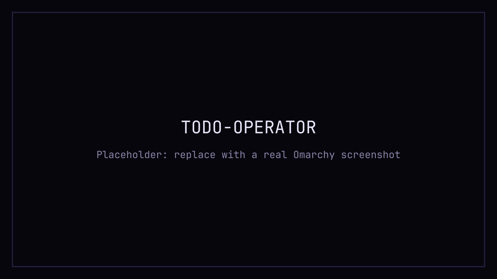

<!-- Generated by themes/generate.py from brand/tokens/umbra.json — do not edit by hand. -->
# Umbra · Omarchy theme

*Dark by default. Sharp by design.* The Umbra palette for [Omarchy](https://learn.omacom.io): deep violet-black surfaces, an ultraviolet accent, plasma and ion highlights.

## Install

```sh
omarchy theme install https://github.com/Robertcl795/omarchy-umbra-theme.git
omarchy theme set umbra
```

Or from the Omarchy menu: Install > Style > Theme, then paste the repo URL. `omarchy theme install` clones this repo into `~/.config/omarchy/themes/umbra` and applies it, so `omarchy theme set umbra` is only needed to switch back to it later.

## Screenshot



TODO-OPERATOR: `preview.png` is a placeholder until a real screenshot is taken (16:9, a terminal and an editor, the theme's own wallpaper, no cursor, notifications or personal data).

## Files

| File | Purpose |
|---|---|
| `colors.toml` | the core keys Omarchy renders every app config from |
| `icons.theme` | icon theme name |
| `backgrounds/umbra-glitch.png`, `backgrounds/umbra-penumbra.png` | wallpapers, 3840×2160 (16:9) |
| `preview.png` | screenshot for the theme menu and omarchy.org |
| `scripts/verify.sh` | layout check (`bash scripts/verify.sh`) |

## Colors

| name | hex | role |
|---|---|---|
| void | `#07060D` | background, deepest (terminal) |
| umbra | `#0E0B1A` | background, panels and editor |
| penumbra | `#171329` | raised surfaces |
| dusk | `#241E3D` | borders and dividers |
| ash | `#8A84A8` | secondary text |
| starlight | `#E8E4F7` | primary text |
| ultraviolet | `#8F73FF` | primary accent: selection, links, active border |
| plasma | `#FF4FAE` | secondary accent: prompt, emphasis |
| ion | `#2BE4FF` | info, cursor, paths |
| corona | `#FFC857` | highlight and warnings |
| ok | `#3DF5A0` | success |
| error | `#FF5C7A` | failure, overdue |
| link | `#6C9BFF` | ANSI blue, syntax |

Every file is generated from Umbra's brand tokens by `themes/generate.py` in the Umbra repo; edits here are overwritten.

## License

- `colors.toml`, `icons.theme`, `README.md`, `scripts/`: MIT.
- `backgrounds/`, `preview.png`: CC BY 4.0.

See [LICENSE](LICENSE).
